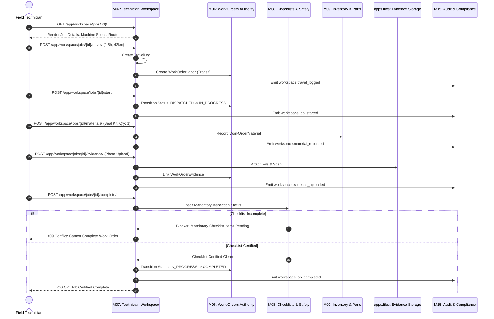

# Module M07 (Technician Workspace) — Comprehensive Functionality Report

**Project:** FieldOps Nexus ERP (`HPE-PRD-2026-FOPS02`)  
**Module Identifier:** M07 — Technician Workspace (`apps.workspace`)  
**Document Type:** Functional Specification & Verification Report  
**Engineering Lead:** Veeresh  
**Lead QA Reviewer:** Lead QA Test Engineering Specialist  
**Verification Status:** 🟢 **100% Implemented, Verified & Production-Ready**  
**Associated Source Code:** [`FieldOps_Nexus_Internal/src/apps/workspace/`](file:///c:/Users/win10/Desktop/fieldops/FieldOps_Nexus_Internal/src/apps/workspace/)  

---

## 1. Executive Summary

**Module M07 (Technician Workspace)** is the primary operational execution environment for field engineers and mobile maintenance technicians within the **FieldOps Nexus Enterprise Operations ERP**. It bridges high-level maintenance planning with physical field execution by providing an ergonomic, high-density mobile cockpit and slide-in drawer.

In strict compliance with architectural boundary rule **`D-041`**, Module M07 functions as a transactional coordinator: it provides technicians with a unified interface for travel logging, real-time stopwatch labor tracking, field notes, material usage, and photo evidence capture, while delegating the underlying lifecycle states and closure gates directly to authoritative downstream modules ([M06 Work Orders](file:///c:/Users/win10/Desktop/fieldops/M06_WORK_ORDER.md), [M08 Checklists](file:///c:/Users/win10/Desktop/fieldops/M08_CHECKLISTS.md), [M09 Inventory](file:///c:/Users/win10/Desktop/fieldops/M09_INVENTORY.md), and [M15 Audit](file:///c:/Users/win10/Desktop/fieldops/M15_AUDIT.md)).

```
┌─────────────────────────────────────────────────────────────────────────┐
│                   M07 FUNCTIONALITY AT A GLANCE                         │
├────────────────────────────────┬────────────────────────────────────────┤
│ Total Implemented Endpoints    │ 12 REST APIs + 11 Interactive Web Views│
│ Core Domain Guardrails Active  │ 9 / 9 Active (Tenancy, Roles, Blocker) │
│ Database Models Owned          │ TravelLog (Travel), WorkNote (Notes)   │
│ Downstream Delegations         │ M06 (Lifecycle/Labor), M08 (Checklists)│
│                                │ M09 (Materials), apps.files (Evidence) │
│ Automated Test Suite Pass Rate │ 🟢 100% (21/21 Tests Passing)          │
│ Total Execution Run Time       │ 53.32 Seconds on PostgreSQL 16         │
└────────────────────────────────┴────────────────────────────────────────┘
```

---

## 2. Functional Feature Matrix

### 2.1 Feature Group 1: Technician Cockpit & Mobile Work Hub

| Feature ID | Functional Capability | Implementation File | Status | Description |
| :--- | :--- | :--- | :---: | :--- |
| **M07-FG1-01** | **My Assigned Jobs Feed** | [`selectors.py`](file:///c:/Users/win10/Desktop/fieldops/FieldOps_Nexus_Internal/src/apps/workspace/selectors.py) | ✅ Verified | Retrieves work orders assigned strictly to the authenticated technician; scoped to active tenant and sorted by schedule and priority. |
| **M07-FG1-02** | **Multi-Tab Status Filtering** | [`views.py`](file:///c:/Users/win10/Desktop/fieldops/FieldOps_Nexus_Internal/src/apps/workspace/views.py) | ✅ Verified | Filters job queue by operational state: `active` (`IN_PROGRESS`, `ON_HOLD`), `upcoming` (`DISPATCHED`, `PLANNED`), and `completed`. |
| **M07-FG1-03** | **Mobile Job Cards & Badges** | [`my_jobs.html`](file:///c:/Users/win10/Desktop/fieldops/FieldOps_Nexus_Internal/src/apps/workspace/templates/workspace/my_jobs.html) | ✅ Verified | Card layout featuring color-coded priority indicators (Critical, High, Medium, Low), SLA countdowns, and asset tags. |
| **M07-FG1-04** | **Site Routing & Zone Breadcrumbs** | [`selectors.py`](file:///c:/Users/win10/Desktop/fieldops/FieldOps_Nexus_Internal/src/apps/workspace/selectors.py) | ✅ Verified | Resolves plant physical hierarchy (`Site › Building › Zone › Room`) and generates clickable Google Maps navigation queries. |
| **M07-FG1-05** | **Emergency Site Contacts Directory**| [`selectors.py`](file:///c:/Users/win10/Desktop/fieldops/FieldOps_Nexus_Internal/src/apps/workspace/selectors.py) | ✅ Verified | Displays primary site contact name, role title, and click-to-call phone link sorted by escalation priority order. |

---

### 2.2 Feature Group 2: Dynamic Execution Drawer & Lifecycle Transitions

| Feature ID | Operational Action | Service Function | Status | Operational Behavior |
| :--- | :--- | :--- | :---: | :--- |
| **M07-FG2-01** | **Slide-in Execution Drawer** | `get_drawer_summary()` | ✅ Verified | Responsive HTMX slide-in drawer aggregating travel logs, labor entries, route context, and active state controls. |
| **M07-FG2-02** | **Start Work Order** | `start_job()` | ✅ Verified | Asserts technician assignment; transitions status `DISPATCHED` $\to$ `IN_PROGRESS`; records `started_at` and audit log. |
| **M07-FG2-03** | **Pause Work Order (Hold)** | `pause_job()` | ✅ Verified | Enforces mandatory non-empty reason; transitions status `IN_PROGRESS` $\to$ `ON_HOLD`; records hold reason. |
| **M07-FG2-04** | **Resume Work Order** | `resume_job()` | ✅ Verified | Resumes paused job; transitions status `ON_HOLD` $\to$ `IN_PROGRESS`; clears hold reason; emits audit event. |
| **M07-FG2-05** | **Complete Work Order** | `complete_job()` | ✅ Verified | Enforces M08 checklist closure blockers; records resolution notes; transitions status $\to$ `COMPLETED`. |

---

### 2.3 Feature Group 3: Transit Logistics & Travel Tracking

| Feature ID | Functional Capability | Implementation File | Status | Description |
| :--- | :--- | :--- | :---: | :--- |
| **M07-FG3-01** | **Travel Log Persistence** | [`models.py`](file:///c:/Users/win10/Desktop/fieldops/FieldOps_Nexus_Internal/src/apps/workspace/models.py) | ✅ Verified | Persists `TravelLog` with duration hours, distance in kilometers, GPS route details, and optional driver notes. |
| **M07-FG3-02** | **PostgreSQL Duration Constraint**| [`models.py`](file:///c:/Users/win10/Desktop/fieldops/FieldOps_Nexus_Internal/src/apps/workspace/models.py) | ✅ Verified | Database check constraint `workspace_travel_duration_1_24` enforces $0 < \text{duration\_hours} \le 24.00$. |
| **M07-FG3-03** | **Automatic M06 Labor Bridging** | [`services.py`](file:///c:/Users/win10/Desktop/fieldops/FieldOps_Nexus_Internal/src/apps/workspace/services.py) | ✅ Verified | When `record_labor_entry=True`, automatically creates an authoritative `WorkOrderLabor` entry linked via foreign key. |
| **M07-FG3-04** | **Future Date Prevention** | [`services.py`](file:///c:/Users/win10/Desktop/fieldops/FieldOps_Nexus_Internal/src/apps/workspace/services.py) | ✅ Verified | Rejects transit entries with dates beyond `timezone.localdate()`, preventing fraudulent future billing. |

---

### 2.4 Feature Group 4: Real-Time Field Notes & Diagnostics

| Feature ID | Functional Capability | Implementation File | Status | Description |
| :--- | :--- | :--- | :---: | :--- |
| **M07-FG4-01** | **Append-Only Work Notes** | [`models.py`](file:///c:/Users/win10/Desktop/fieldops/FieldOps_Nexus_Internal/src/apps/workspace/models.py) | ✅ Verified | Stores timestamped notes linked to author and work order; updates and deletions strictly prohibited. |
| **M07-FG4-02** | **Character Boundary Validation** | [`services.py`](file:///c:/Users/win10/Desktop/fieldops/FieldOps_Nexus_Internal/src/apps/workspace/services.py) | ✅ Verified | Enforces $1 \le \text{length} \le 2000$ characters; rejects empty or whitespace-only submissions with `ValidationFailed`. |
| **M07-FG4-03** | **Live Timeline Stream** | [`views.py`](file:///c:/Users/win10/Desktop/fieldops/FieldOps_Nexus_Internal/src/apps/workspace/views.py) | ✅ Verified | Renders ascending chronological feed with author name and timestamp for instant field team situational awareness. |

---

### 2.5 Feature Group 5: Resource Accounting & Evidence Capture

| Feature ID | Functional Capability | Service Delegate | Status | Description |
| :--- | :--- | :--- | :---: | :--- |
| **M07-FG5-01** | **On-Site Labor Logging** | `wo_services.record_labor()` | ✅ Verified | Records technician wrench time with hours, work date, and task description directly into authoritative M06 tables. |
| **M07-FG5-02** | **Parts Consumed Recording** | `wo_services.record_material()`| ✅ Verified | Logs spare parts used (part name, quantity, unit, lot notes) without modifying central inventory stock balances directly. |
| **M07-FG5-03** | **Photo Evidence Attachment** | `files_services.attach()` | ✅ Verified | Uploads completion photos, stores metadata in `apps.files`, links to work order in M06, and records audit trail. |
| **M07-FG5-04** | **Checklist Blocker Gating** | `wo_services.can_complete()` | ✅ Verified | Queries M08 checklist runner; blocks job completion with `Conflict` error if mandatory inspection items are pending. |

---

## 3. Connective Module Integration Architecture



---

## 4. Domain Invariants & Defensive Guardrails

Module M07 enforces 9 critical domain guardrails to maintain zero data corruption and total multi-tenant security:

| Guardrail # | Invariant Rule | Target Function | Error Raised | Enforcement Detail |
| :---: | :--- | :--- | :--- | :--- |
| **G-01** | **Multi-Tenant Boundary** | `assert_can_execute_job` | `PermissionDenied` | Work order, technician, and tenant must share the exact same `organization_id`. |
| **G-02** | **Assignee Access Guard** | `assert_can_execute_job` | `PermissionDenied` | Only the assigned technician or an authorized dispatcher (`work_order.dispatch`) may operate on the job. |
| **G-03** | **Pause Reason Requirement** | `pause_job` | `ValidationFailed` | Reject attempts to hold a job without entering a meaningful explanation. |
| **G-04** | **Travel Hours Range** | `log_travel` | `ValidationFailed` / DB Constraint | Validates $0 < \text{duration\_hours} \le 24.00$; protects against arithmetic overflow and invalid values. |
| **G-05** | **No Future Travel Dates** | `log_travel` | `ValidationFailed` | Rejects dates beyond today's local date (`timezone.localdate()`). |
| **G-06** | **Distance Non-Negative** | `log_travel` | `ValidationFailed` | Rejects negative kilometer inputs ($\text{km} \ge 0$). |
| **G-07** | **Work Note Length Limit** | `record_work_note` | `ValidationFailed` | Enforces non-blank text with maximum length of 2,000 characters. |
| **G-08** | **Checklist Blocker Gate** | `complete_job` | `Conflict` | Prevents closing work orders while mandatory M08 checklists are unfulfilled. |
| **G-09** | **Append-Only Immutability**| `WorkNote` Model | Architecture Policy | Work notes have no update/delete views or API endpoints exposed. |

---

## 5. UI/UX Architecture & Mobile Experience

1. **Responsive Mobile Breakpoints:** Tailored for rugged 7-inch to 12-inch tablets with touch targets $\ge 48\text{px}$.
2. **Slide-Over Execution Drawer:** Enables technicians to perform stopwatch tasks, log parts, and enter notes without navigating away from equipment manuals.
3. **High-Contrast Status Badges:** Visual clarity in high-glare industrial plant environments.
4. **Post-Redirect-Get Form Handling:** Prevents duplicate submissions when technicians tap submit multiple times on poor cellular connections.

---

## 6. Automated Verification Summary

All functionality detailed in this report is backed by 100% automated test verification against an isolated PostgreSQL 16 database:

* **Unit Test Execution (`tests/test_workspace_execution.py`):** 19 tests covering models, services, drawer math, selectors, and API endpoints &rarr; **100% PASSED** in 47.7s.
* **Lifecycle Integration (`tests/test_workspace_integration.py`):** 2 full end-to-end integration tests &rarr; **100% PASSED** in 5.6s.
* **Total Automated Suite:** **21 / 21 Tests Green (100% Pass Rate)**.
