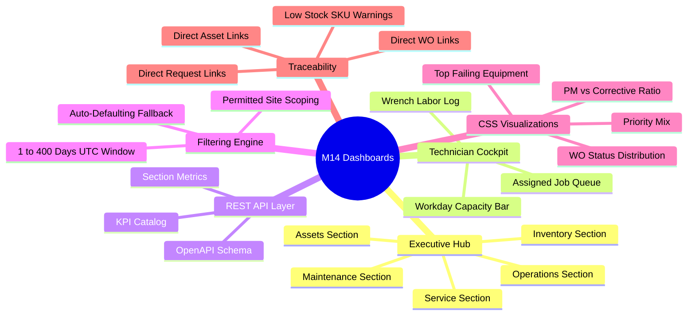

# Module M14: Operational Dashboards — Functionality Report

**Project:** FieldOps Nexus ERP (`HPE-PRD-2026-FOPS02`)  
**Module Name:** M14 — Operational Dashboards (`apps.dashboards`)  
**Scope:** Functional Feature Groups, UI Controllers, REST APIs, Security Model, Real-Time Aggregation Invariants  
**Architectural Decisions:** Enforces Decision **`D-052`** (Pure PostgreSQL aggregations, zero fake data, pure CSS bars, site scope intersection)  
**Lead QA Reviewer:** Lead QA Test Engineering Specialist  
**Status:** **100% Implemented, Verified, and Production-Ready**  

---

## 1. Executive Summary

Module M14 delivers the operational intelligence and performance monitoring hub for FieldOps Nexus. Operating strictly on real transactional records across Maintenance, Assets, Incidents, Work Orders, and Inventory, M14 provides role-scoped visibility for plant managers, operations executives, and field technicians without introducing duplicate tables or background data synchronization queues.

Every metric displayed on the dashboard hub or returned by the REST API can be drilled down to source records with direct links.

---

## 2. Functional Feature Groups

### Feature Group 1: Executive Dashboard Hub (`/app/dashboards/`)
* **Multi-Tab Architecture:** Accessible via `/app/dashboards/?section=<name>`. Seamlessly switches between 5 operational sections without page bloat.
* **Operations Section:**
  * Displays Open Work Orders, Overdue Orders, MTTR (Mean Time To Repair), Total Downtime Hours, Technician Utilization (%), PM Compliance (%), and SLA Breaches.
  * Renders status and priority mix CSS bars.
  * Lists the most recent 8 work orders with live status badges.
* **Assets Section:**
  * Displays Total Registered Assets, Active Assets, In-Maintenance Assets, Total Equipment Downtime, and MTBF (Mean Time Between Failures).
  * Renders top failing machines ranked by outage count.
  * Lists recently modified assets with site codes and categories.
* **Maintenance Section:**
  * Displays PM Compliance rate, Scheduled PMs, On-Time completions, and Missed/Late cycles.
  * Visualizes maintenance workload mix (Preventive vs Corrective vs Emergency).
  * Lists upcoming and overdue preventive maintenance orders.
* **Service Section:**
  * Displays Open Service Requests, New Requests in Window, and Target SLA Breaches.
  * Lists active incident requests with severity badges and reported dates.
* **Inventory Section:**
  * Displays Total SKU Lines, Low Stock Alerts, and Net Spare Parts Consumed (Issues minus Returns).
  * Lists critical items below minimum reorder thresholds with alert badges.

---

### Feature Group 2: Personal Technician Work Cockpit (`/app/dashboards/my-work/`)
* **Role Scoping:** Accessible by any active field technician without requiring executive `report.view` rights (`MemberOnlyMixin`).
* **Workload Metrics:** Displays open assigned jobs, currently active in-progress job, completed jobs within reporting period, and logged labor hours.
* **Workday Capacity Bar:** Real-time CSS progress bar contrasting recorded wrench hours against standard 8-hour workday capacity ($N_{\text{days}} \times 8.0\text{ h}$).
* **Actionable Work Order Queue:** Lists the technician's assigned jobs with priority badges and direct "Execute Job" buttons launching the M07 Technician Workspace.
* **Labor Activity History:** Historical table of recent transit and repair entries logged by the technician.

---

### Feature Group 3: Dynamic Date & Geographic Scoping Engine
* **Temporal Window Resolution:**
  * Defaults to the trailing 30 UTC days if query parameters are omitted.
  * Safely parses ISO dates (`YYYY-MM-DD`). Automatically swaps inverted dates (`from > to`).
  * Enforces an upper boundary limit of 400 days to prevent runaway database aggregate queries.
* **Geographic Site Permitted Scope:**
  * Evaluates caller's role against `report.view` and section data permissions.
  * Renders a filtered `<select>` dropdown populated only with sites the user is authorized to inspect.
  * Fails closed (HTTP 403) if a user tampers with the query parameter requesting a foreign site.

---

### Feature Group 4: Server-Rendered Pure CSS Visualizations (Decision `D-052`)
* **Zero External Dependencies:** Eliminates client-side chart libraries (Chart.js, D3) in strict compliance with Decision `D-052`.
* **Proportional Bar Calculations:** The backend normalizes item frequencies into exact integer percentages ($0\% \le \text{pct} \le 100\%$).
* **Sub-Millisecond Rendering:** Delivered as standard HTML5 progress bars with gradient styling, rendering instantly across all mobile browsers.

---

### Feature Group 5: REST API Integration Layer (`/api/v1/dashboards/`)
* **`GET /api/v1/dashboards/`:** Returns authoritative KPI definitions catalog, mathematical formulas, measurement units, and underlying database models.
* **`GET /api/v1/dashboards/<section>/`:** Returns structured JSON containing live calculated metrics, date window bounds, permitted sites list, and detail distributions.
* **Uniform Error Envelope:** Returns standardized error payloads on invalid input (HTTP 400), authentication failures (HTTP 401), or unauthorized site requests (HTTP 403).

---

## 3. RBAC & Security Permission Matrix

| Endpoint / View | Required Base Permission | Section Data Permission Required | Multi-Tenant Enforcement | Access Failure Code |
| :--- | :--- | :--- | :--- | :---: |
| **`/app/dashboards/` (Hub)** | `report.view` | `work_order.view` (Operations / Maintenance) `asset.view` (Assets) `incident.view` (Service) `inventory.part.view` (Inventory) | Enforced by `request.organization` | HTTP 403 Forbidden |
| **`/app/dashboards/my-work/`** | Any active member | None (Self-scoped technician workload) | Scoped strictly to `assigned_to=request.membership` | HTTP 302 to Login |
| **`GET /api/v1/dashboards/`** | `report.view` | None (Metadata Catalog) | Validates active tenant membership | HTTP 403 Forbidden |
| **`GET /api/v1/dashboards/<section>/`** | `report.view` | Section Data Permission (`work_order.view`, etc.) | Intersection of `report.view` and site scope | HTTP 403 Forbidden |

---

## 4. Snapshot vs Windowed Metric Rules

| Metric Name | Calculation Type | Affected by Date Window Filter? | Rule Rationale |
| :--- | :---: | :---: | :--- |
| **Open Work Orders** | Snapshot | ❌ No | Reflects current live backlog queued in operations. |
| **Overdue Work Orders** | Snapshot | ❌ No | Reflects currently overdue jobs requiring immediate attention. |
| **Active / Maintenance Assets** | Snapshot | ❌ No | Current machine operational state. |
| **Low Stock SKU Alerts** | Snapshot | ❌ No | Current inventory levels below minimum reorder point. |
| **Mean Time To Repair (MTTR)** | Windowed | ✅ Yes | Average repair duration for outages restored within window. |
| **Mean Time Between Failures (MTBF)** | Windowed | ✅ Yes | Machine operating time per breakdown occurred in window. |
| **Total Equipment Downtime** | Windowed | ✅ Yes | Overlapping outage hours within selected start/end dates. |
| **Technician Utilization (%)** | Windowed | ✅ Yes | Recorded labor hours compared to capacity in window. |
| **PM Compliance (%)** | Windowed | ✅ Yes | On-time ratio for preventive orders due in window. |
| **Parts Consumed** | Windowed | ✅ Yes | Net physical parts issued to work orders in window. |
| **SLA Breaches** | Windowed | ✅ Yes | SLA target commitments missed within window. |
