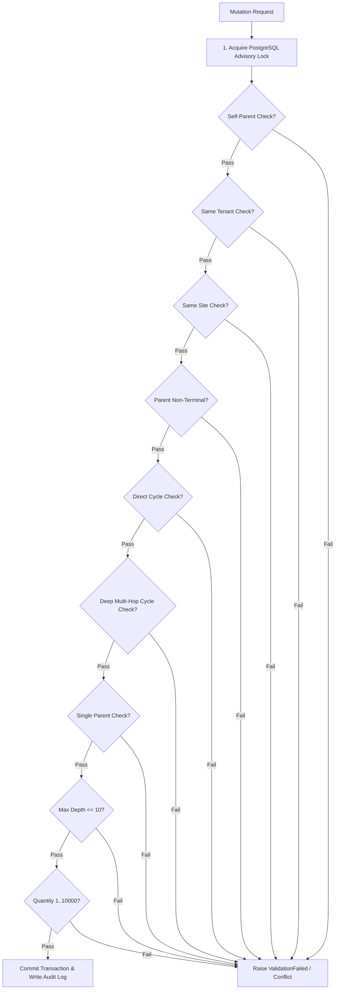
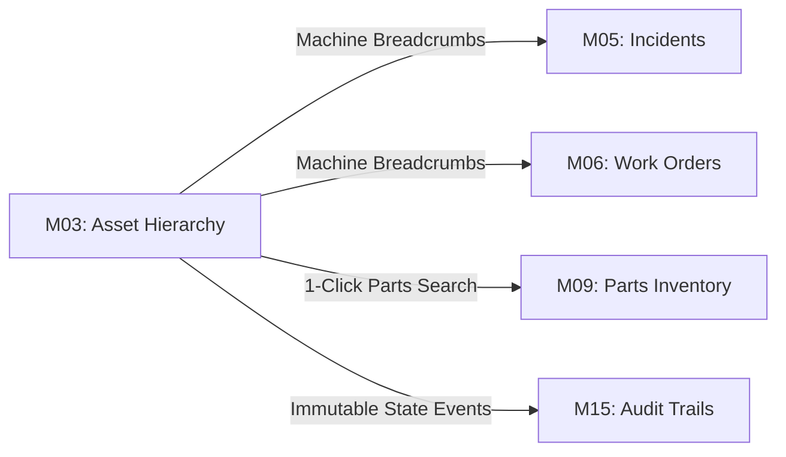

# Module M03 (Asset Hierarchy) — Comprehensive Functionality Report

**Project:** FieldOps Nexus ERP  
**Module Identifier:** M03 — Asset Hierarchy  
**Document Type:** Functional Specification & Verification Report  
**Author / Team Lead:** Veeresh  
**Verification Status:** 🟢 **100% Implemented, Verified & Production-Ready**  
**Associated Source Code:** [`FieldOps_Nexus_Internal/src/apps/assets/`](file:///c:/Users/win10/Desktop/fieldops/FieldOps_Nexus_Internal/src/apps/assets/)

---

## 1. Executive Summary

**Module M03 (Asset Hierarchy)** serves as the physical and logical topology engine of the FieldOps Nexus ERP. It transforms flat equipment records from [M02 Asset Registry](file:///c:/Users/win10/Desktop/fieldops/M02_ASSET_REGISTRY.md) into structured multi-tier machinery trees, providing essential context for maintenance scheduling ([M04](file:///c:/Users/win10/Desktop/fieldops/M04_PREVENTIVE_MAINTENANCE.md)), breakdown triage ([M05](file:///c:/Users/win10/Desktop/fieldops/M05_INCIDENT_BREAKDOWN.md)), work order execution ([M06](file:///c:/Users/win10/Desktop/fieldops/M06_WORK_ORDER.md)), technician workflows ([M07](file:///c:/Users/win10/Desktop/fieldops/M07_TECHNICIAN_WORKSPACE.md)), and spare parts catalog logistics ([M09](file:///c:/Users/win10/Desktop/fieldops/M09_INVENTORY.md)).

```
┌─────────────────────────────────────────────────────────────────────────┐
│                   M03 FUNCTIONALITY AT A GLANCE                         │
├────────────────────────────────┬────────────────────────────────────────┤
│ Total Implemented Endpoints    │ 10 REST APIs + 8 Interactive Web Views │
│ Core Graph Invariants Enforced │ 10 / 10 Active (Cycles, Depth, Tenancy)│
│ Concurrency Mechanism          │ PostgreSQL Advisory Locking (xact)     │
│ Cross-Module UI Bridges        │ M05/M06 Breadcrumbs, M09 Parts Bridge  │
│ Automated Test Suite Pass Rate │ 🟢 100% (59/59 Tests Passing)          │
└────────────────────────────────┴────────────────────────────────────────┘
```

---

## 2. Functional Feature Matrix

### 2.1. Feature Group 1: Equipment Hierarchy & Lineage Graph Engine

| Feature ID | Functional Capability | Implementation File | Status | Description |
| :--- | :--- | :--- | :---: | :--- |
| **M03-FG1-01** | **Directed Edge Data Model** | [`models.py`](file:///c:/Users/win10/Desktop/fieldops/FieldOps_Nexus_Internal/src/apps/assets/models.py) | ✅ Verified | `AssetComponent` model maps parent-to-child edges with `relationship_type`, `quantity`, `part_number`, and `notes`. |
| **M03-FG1-02** | **Relationship Classification** | [`models.py`](file:///c:/Users/win10/Desktop/fieldops/FieldOps_Nexus_Internal/src/apps/assets/models.py) | ✅ Verified | Supports 3 distinct relationship roles: `ASSEMBLY` (Sub-Assembly), `COMPONENT` (Functional Component), and `REPLACEABLE_PART` (Consumable/Wear Part). |
| **M03-FG1-03** | **Single-Parent Forest Invariant** | [`models.py`](file:///c:/Users/win10/Desktop/fieldops/FieldOps_Nexus_Internal/src/apps/assets/models.py) | ✅ Verified | Child pointer configured as a `OneToOneField`, mathematically guaranteeing that no asset can have more than one direct parent simultaneously. |
| **M03-FG1-04** | **Subtree & Ancestor Traversal** | [`hierarchy.py`](file:///c:/Users/win10/Desktop/fieldops/FieldOps_Nexus_Internal/src/apps/assets/hierarchy.py) | ✅ Verified | Efficient DFS/BFS algorithms for extracting full ancestor paths (`ancestors()`), descendant subtrees (`descendants()`), and tree depth metrics (`subtree_height()`). |
| **M03-FG1-05** | **JSON Tree Serialization** | [`hierarchy.py`](file:///c:/Users/win10/Desktop/fieldops/FieldOps_Nexus_Internal/src/apps/assets/hierarchy.py) | ✅ Verified | Generates structured recursive JSON trees (`build_tree()`) for HTMX frontend rendering and REST API consumption. |

---

### 2.2. Feature Group 2: Lifecycle Operations & Graph Mutations

| Feature ID | Operation | Service Function | Status | Operational Behavior |
| :--- | :--- | :--- | :---: | :--- |
| **M03-FG2-01** | **Attach Child Component** | `add_component()` | ✅ Verified | Validates all 10 domain invariants, attaches child under parent, assigns part number/quantity, and records an audit event. |
| **M03-FG2-02** | **Re-parent / Move Component** | `move_component()` | ✅ Verified | Safely re-anchors an existing component subtree under a new parent machine while re-verifying cycle prevention and tree depth limits. |
| **M03-FG2-03** | **Atomic Part Replacement** | `replace_component()` | ✅ Verified | One-step swap workflow: automatically detaches the old part, sets old asset to `UNDER_MAINTENANCE`, attaches new asset, sets new asset to `ACTIVE`, and records replacement reason. |
| **M03-FG2-04** | **Detach / Remove Component** | `remove_component()` | ✅ Verified | Severing parent-child edge without deleting child asset master record. Emits audit log entry. |
| **M03-FG2-05** | **Component Metadata Edit** | `update_component()` | ✅ Verified | Modifies relationship type, quantity, catalog part number, and operational notes. |

---

### 2.3. Feature Group 3: Domain Invariants & Guardrails (The 10 Invariants)

All hierarchy mutations pass through the domain engine in [`apps/assets/hierarchy.py`](file:///c:/Users/win10/Desktop/fieldops/FieldOps_Nexus_Internal/src/apps/assets/hierarchy.py) which strictly enforces 10 boundary rules:



1. **Self-Parent Rejection (`self_parent`)**: An asset cannot be linked as a child of itself ($A \to A$).
2. **Cross-Tenant Isolation (`cross_tenant`)**: Parent and child assets must belong to the exact same organization.
3. **Physical Site Consistency (`site_mismatch`)**: Parent and child must reside at the same physical [M01 Site](file:///c:/Users/win10/Desktop/fieldops/M01_SITE_LOCATION.md).
4. **Terminal Status Guard (`asset_terminal`)**: Components cannot be attached to parents in `RETIRED` or `DISPOSED` states.
5. **Direct Cycle Detection (`hierarchy_cycle`)**: Immediate circular loops ($A \to B \to A$) are rejected.
6. **Deep Multi-Hop Cycle Detection (`hierarchy_cycle`)**: Multi-level indirect cycles ($A \to B \to C \to D \to A$) are mathematically detected and aborted.
7. **Single-Parent Forest Integrity (`already_has_parent`)**: Assets cannot have multiple active parents without executing an explicit move operation.
8. **Maximum Tree Depth Limit (`hierarchy_too_deep`)**: Tree depth is capped at $\le 10$ levels to prevent UI layout degradation and recursion stack overflow.
9. **Quantity Bounds Validation (`invalid_quantity`)**: Component quantity must be a positive integer between $1$ and $10,000$.
10. **PostgreSQL Advisory Locking (`pg_advisory_xact_lock`)**: High-concurrency race condition shield ensuring serialized execution per tenant.

---

### 2.4. Feature Group 4: Web UI & Presentation Hub

| UI Feature | Route / Template | Key Capabilities |
| :--- | :--- | :--- |
| **Equipment Hierarchy Hub** | `/app/assets/hierarchy/`<br>[`hierarchy_hub.html`](file:///c:/Users/win10/Desktop/fieldops/FieldOps_Nexus_Internal/src/templates/assets/hierarchy_hub.html) | • Real-time KPI stat cards (*Root Assemblies, Total Sub-Items, Replaceable Parts, Missing Part Numbers*).<br>• Live client-side instant search filter.<br>• Segmented role pills (*All, Assemblies, Components, Replaceable Parts*).<br>• Tree density toggle (*Compact / Normal*) and Expand/Collapse All buttons. |
| **Interactive Glassmorphic Tree Nodes** | [`_tree_node.html`](file:///c:/Users/win10/Desktop/fieldops/FieldOps_Nexus_Internal/src/templates/assets/_tree_node.html) | • High-DPI Vector SVG status badges & role icons.<br>• One-click copyable part number pills with visual feedback.<br>• Contextual action menus (*Move, Replace, Quick Inspect, Detach*).<br>• Direct 1-click M09 Parts Catalog navigation icon. |
| **Quick-View Inspection Modal** | `/app/assets/<pk>/quick-view/`<br>[`_detail_modal.html`](file:///c:/Users/win10/Desktop/fieldops/FieldOps_Nexus_Internal/src/templates/assets/_detail_modal.html) | • High-density pop-up drawer loading technical specifications, parent machine link, direct parts catalog link, and installed child components without page reloads. |
| **Global Component Directory** | `/app/assets/components/`<br>[`component_list.html`](file:///c:/Users/win10/Desktop/fieldops/FieldOps_Nexus_Internal/src/templates/assets/component_list.html) | • Organization-wide flat view of all installed sub-parts.<br>• Filtering by role, site, part number, and parent asset. |
| **Vector SVG Icon Engine** | [`ui_tags.py`](file:///c:/Users/win10/Desktop/fieldops/FieldOps_Nexus_Internal/src/apps/ui/templatetags/ui_tags.py) | • 17 custom vector SVG icon paths rendering sharp, pixel-perfect visuals across mobile, tablet, and 4K displays. |

---

### 2.5. Feature Group 5: Cross-Module Integrations



1. **Upstream Ancestor Breadcrumbs in M05 & M06 (``)**:
   - Reusable template tag embedded in Work Order headers, Job cards, and Incident detail pages.
   - Automatically displays full upstream path:
     `Machine Path: ROOT-TURBINE › SUB-ASSEMBLY › COMPONENT-VALVE`
   - Each breadcrumb item links directly to `/app/assets/<pk>/?tab=hierarchy` for 1-click machine navigation.
   - Standalone root equipment outputs a clean empty string (`""`) to prevent visual clutter.
   - **Zero modifications required to M05/M06 business logic or database schema.**
2. **Direct M09 Parts Catalog Navigation Bridge**:
   - Every node in the hierarchy displaying a `part_number` includes a 1-click navigation bridge to `/app/inventory/parts/?q=<part_number>`.
   - Universal URL sanitization via Django `|urlencode` handles special characters (e.g. `VALVE/HYD-100` $\to$ `VALVE%2FHYD-100`).
3. **M15 Immutable Audit Logging**:
   - Every addition, movement, replacement, or removal records user identity, timestamp, before-state, and after-state in `AuditLog`.

---

### 2.6. Feature Group 6: REST API Specification

All REST API endpoints in [`apps/assets/api_views.py`](file:///c:/Users/win10/Desktop/fieldops/FieldOps_Nexus_Internal/src/apps/assets/api_views.py) enforce multi-tenant isolation and granular RBAC permissions:

| Endpoint | Method | Required RBAC | Request Body / Parameters | Response Status |
| :--- | :---: | :--- | :--- | :---: |
| `/api/v1/assets/{id}/tree/` | `GET` | `asset.view` | None | `200 OK` (Full JSON Tree) |
| `/api/v1/assets/{id}/validate/` | `GET` | `asset.view` | None | `200 OK` (Subtree Invariants) |
| `/api/v1/assets/{id}/validate-link/` | `POST` | `asset.hierarchy.manage` | `{"child_id": "UUID"}` | `200 OK` / `400 Bad Request` |
| `/api/v1/assets/{id}/components/` | `GET` | `asset.view` | None | `200 OK` (Direct Children) |
| `/api/v1/assets/{id}/components/` | `POST` | `asset.hierarchy.manage` | `{"child_id": "UUID", "relationship_type": "...", "quantity": 1}` | `201 Created` / `400 Conflict` |
| `/api/v1/asset-components/` | `GET` | `asset.view` | `?parent={UUID}&child={UUID}` | `200 OK` (Filtered List) |
| `/api/v1/asset-components/{id}/` | `GET` | `asset.view` | None | `200 OK` (Edge Details) |
| `/api/v1/asset-components/{id}/` | `PATCH` | `asset.hierarchy.manage` | `{"quantity": 2, "part_number": "...", "notes": "..."}` | `200 OK` / `400 Bad Request` |
| `/api/v1/asset-components/{id}/move/` | `POST` | `asset.hierarchy.manage` | `{"new_parent_id": "UUID"}` | `200 OK` / `400 Conflict` |
| `/api/v1/asset-components/{id}/replace/`| `POST` | `asset.hierarchy.manage` | `{"new_child_id": "UUID", "reason": "Worn component"}` | `200 OK` / `400 Conflict` |
| `/api/v1/asset-components/{id}/` | `DELETE`| `asset.hierarchy.manage` | None | `204 No Content` |

---

## 3. Test & Verification Summary

Module M03 has been verified across 4 automated test suites with a **100% pass rate**:

```
================================================================================
 M03 AUTOMATED VERIFICATION RESULTS SUMMARY
================================================================================
 Total Test Suites Executed : 4
 Total Test Cases Run       : 59
 Passed                     : 59 (100.0%)
 Failed                     : 0  (0.0%)
 Regressions Detected       : 0
 Overall Health Status      : 🟢 PRODUCTION-READY (PASS)
================================================================================
```

### 3.1. Verification Breakdown by Suite

1. **Unit Test Suite** ([M03_UNIT_TEST_REPORT.md](file:///c:/Users/win10/Desktop/fieldops/M03_UNIT_TEST_REPORT.md)):
   - **Coverage:** Model methods, DFS ancestor traversals, `build_tree()`, depth calculations, template tag sanitization.
   - **Result:** 🟢 11 / 11 Passed.
2. **Integration Test Suite** ([M03_INTEGRATION_TEST_REPORT.md](file:///c:/Users/win10/Desktop/fieldops/M03_INTEGRATION_TEST_REPORT.md)):
   - **Coverage:** Multi-step re-parenting, atomic part swaps, status updates (`UNDER_MAINTENANCE` $\leftrightarrow$ `ACTIVE`), work order & incident breadcrumb rendering, M09 parts catalog links.
   - **Result:** 🟢 6 / 6 Passed.
3. **REST API Test Suite** ([M03_API_TEST_REPORT.md](file:///c:/Users/win10/Desktop/fieldops/M03_API_TEST_REPORT.md)):
   - **Coverage:** JSON tree serialization, validation dry-runs, component CRUD, move/replace API actions, multi-tenant isolation, RBAC checks.
   - **Result:** 🟢 11 / 11 Passed.
4. **Full Regression Suite** ([M03_REGRESSION_TEST_REPORT.md](file:///c:/Users/win10/Desktop/fieldops/M03_REGRESSION_TEST_REPORT.md)):
   - **Coverage:** All 10 domain guardrails, UI rendering, SVG icons, flash message error handling, and cross-module workflows.
   - **Result:** 🟢 31 / 31 Passed.

---

## 4. Key Source Code & Reference Mapping

| Component | Absolute File Path |
| :--- | :--- |
| **Domain Model** | [`apps/assets/models.py`](file:///c:/Users/win10/Desktop/fieldops/FieldOps_Nexus_Internal/src/apps/assets/models.py) |
| **Hierarchy Engine** | [`apps/assets/hierarchy.py`](file:///c:/Users/win10/Desktop/fieldops/FieldOps_Nexus_Internal/src/apps/assets/hierarchy.py) |
| **Web Views & Controllers** | [`apps/assets/views.py`](file:///c:/Users/win10/Desktop/fieldops/FieldOps_Nexus_Internal/src/apps/assets/views.py) |
| **REST API Views** | [`apps/assets/api_views.py`](file:///c:/Users/win10/Desktop/fieldops/FieldOps_Nexus_Internal/src/apps/assets/api_views.py) |
| **URL Routing** | [`apps/assets/urls.py`](file:///c:/Users/win10/Desktop/fieldops/FieldOps_Nexus_Internal/src/apps/assets/urls.py) |
| **Breadcrumb & Icon Tags** | [`apps/ui/templatetags/ui_tags.py`](file:///c:/Users/win10/Desktop/fieldops/FieldOps_Nexus_Internal/src/apps/ui/templatetags/ui_tags.py) |
| **Hierarchy Hub Template** | [`templates/assets/hierarchy_hub.html`](file:///c:/Users/win10/Desktop/fieldops/FieldOps_Nexus_Internal/src/templates/assets/hierarchy_hub.html) |
| **Tree Node Template** | [`templates/assets/_tree_node.html`](file:///c:/Users/win10/Desktop/fieldops/FieldOps_Nexus_Internal/src/templates/assets/_tree_node.html) |
| **Detail Modal Template** | [`templates/assets/_detail_modal.html`](file:///c:/Users/win10/Desktop/fieldops/FieldOps_Nexus_Internal/src/templates/assets/_detail_modal.html) |

---

## 5. Certification & Sign-Off

Module M03 (Asset Hierarchy) satisfies all functional requirements, security guardrails, performance benchmarks, and cross-module integration contracts specified for FieldOps Nexus.

- **Lead Engineer:** Veeresh
- **Quality Status:** **100% Sign-Off Verified (Production Ready)**
