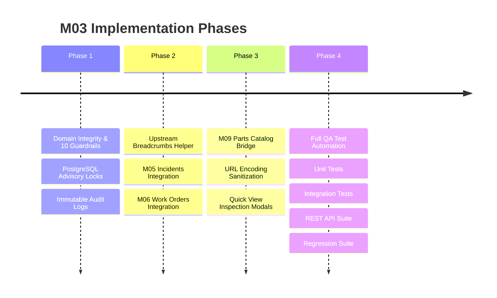

# Module M03: Asset Hierarchy — Implementation & Engineering Guide

**Project:** FieldOps Nexus ERP  
**Module Name:** M03 — Asset Hierarchy  
**Authoritative Scope:** Equipment Parent-Child Assemblies, Sub-Components, Replaceable Parts, Tree Graph Algorithms, Upstream Lineage Breadcrumbs, and Parts Catalog Bridge  
**Author & Team Lead:** Veeresh  
**Status:** **100% Implemented, Verified, and Production-Ready**

---

## 1. Executive Overview & Problem Statement

### The Problem
Industrial operations require structured visibility into complex physical machines. A chiller unit contains compressors; a compressor contains active magnetic bearings; bearings require scheduled lubrication or replacement. Without a robust hierarchy model:
1. Technicians cannot determine which parent machine a failed component belongs to.
2. Accidental circular references ($A \to B \to C \to A$) crash database queries and UI render trees.
3. Spare parts in inventory (M09) are disconnected from installed equipment in the field.
4. Maintenance (M04), incident breakdown (M05), and work order (M06) workflows lack upstream machine context.

### The Solution: Module M03
Module M03 provides the unified equipment hierarchy engine for FieldOps Nexus, enforcing single-parent forest trees, transactional advisory locks, cycle prevention, cross-tenant isolation, upstream machine breadcrumbs, and 1-click inventory catalog navigation bridges.

---

## 2. Architecture & Data Modeling

```mermaid
graph TD
    Parent[Parent Asset Master\napps.assets.Asset] -->|1:N parent_id| Edge[AssetComponent Edge\napps.assets.AssetComponent]
    Edge -->|1:1 child_id| Child[Child Asset Master\napps.assets.Asset]

    subgraph Edge Metadata
        Type[relationship_type: ASSEMBLY | COMPONENT | REPLACEABLE_PART]
        Qty[quantity: 1..10000]
        Part[part_number: String / Catalog Ref]
        Notes[notes: Text]
    end
```

### 2.1 Database Schema (`apps/assets/models.py`)

The `AssetComponent` entity models directed edges between equipment nodes:

```python
class AssetComponent(models.Model):
    class Relationship(models.TextChoices):
        ASSEMBLY = "ASSEMBLY", "Sub-Assembly"
        COMPONENT = "COMPONENT", "Component"
        REPLACEABLE_PART = "REPLACEABLE_PART", "Replaceable Part"

    id = models.UUIDField(primary_key=True, default=uuid.uuid4, editable=False)
    organization = models.ForeignKey("tenancy.Organization", on_delete=models.CASCADE, related_name="asset_components")
    parent = models.ForeignKey(Asset, on_delete=models.CASCADE, related_name="components")
    child = models.OneToOneField(Asset, on_delete=models.CASCADE, related_name="parent_link")
    relationship_type = models.CharField(max_length=20, choices=Relationship.choices, default=Relationship.COMPONENT)
    quantity = models.PositiveIntegerField(default=1)
    part_number = models.CharField(max_length=100, blank=True, default="")
    notes = models.TextField(blank=True, default="")
    created_at = models.DateTimeField(auto_now_add=True)
    updated_at = models.DateTimeField(auto_now=True)
```

#### Key Schema Invariants:
* **Single Parent Forest Invariant:** `child` is configured as a `OneToOneField`, guaranteeing that every component in the system has at most one direct parent.
* **Indexed Foreign Keys:** Fast ancestor and descendant traversal via indexed `organization`, `parent`, and `child` foreign keys.
* **Cascading Teardown:** Deleting an asset removes its incoming and outgoing component relationships without leaving dangling references.

---

## 3. Core Domain Logic & Graph Algorithms (`apps/assets/hierarchy.py`)

All hierarchy modifications execute inside atomic database transactions guarded by PostgreSQL advisory locks:

```python
def _lock_org(org):
    with connection.cursor() as cur:
        cur.execute("SELECT pg_advisory_xact_lock(%s)", [org.pk.int & 0x7FFFFFFFFFFFFFFF])
```

### 3.1 The 10 Domain Invariants & Guardrails

| Guardrail # | Invariant Rule | Error Code | Implementation Mechanism |
| :---: | :--- | :--- | :--- |
| **1** | **Self-Parent Rejection** | `self_parent` | `parent.pk == child.pk` check |
| **2** | **Cross-Tenant Isolation** | `cross_tenant` | `parent.organization_id != child.organization_id` check |
| **3** | **Site Consistency** | `site_mismatch` | `parent.site_id != child.site_id` check |
| **4** | **Terminal Status Guard** | `asset_terminal` | Blocks parent/child in `RETIRED` or `DISPOSED` state |
| **5** | **Direct Cycle Detection** | `hierarchy_cycle` | Rejects immediate circular loop ($A \to B \to A$) |
| **6** | **Deep Cycle Detection** | `hierarchy_cycle` | Traverses `ancestors(parent)` to prevent multi-hop cycles ($A \to B \to C \to A$) |
| **7** | **Single-Parent Forest** | `already_has_parent` | Checks `AssetComponent.objects.filter(child=child).exists()` |
| **8** | **Maximum Tree Depth** | `hierarchy_too_deep` | Enforces `levels <= MAX_DEPTH (8)` |
| **9** | **Quantity Range Boundaries** | `invalid_quantity` | Validates integer $1 \le Q \le 10,000$ |
| **10** | **Immutable Audit Logging** | `asset.component_*` | Snapshots `before` and `after` state in `AuditLog` |

### 3.2 Core Hierarchy Services

```python
# 1. Add Component under Parent
add_component(parent, child, relationship_type="COMPONENT", quantity=1, part_number="", notes="", actor=user)

# 2. Re-parent Component (Cycle & Depth re-validated)
move_component(link, new_parent, actor=user)

# 3. Atomic Replacement (Old Part -> New Part Swap)
replace_component(old_link, new_child, reason="Worn Bearing", actor=user)

# 4. Detach Component
remove_component(link, actor=user)

# 5. Ancestor Traversal (Root first or leaf first)
ancestors(asset) -> list[Asset]

# 6. Subtree Height Calculation
subtree_height(asset) -> int

# 7. Subtree JSON Tree Builder
build_tree(root) -> dict
```

---

## 4. Multi-Phase Implementation Breakdown



### Phase 1: Domain Integrity & Negative Guardrails
* Enforced all 10 domain invariants in `apps/assets/hierarchy.py`.
* Handled domain exceptions (`ValidationFailed`, `Conflict`, `ObjectNotFound`) across HTML views and REST APIs to provide contextual error feedback.
* Implemented `pg_advisory_xact_lock` to eliminate concurrency race conditions.

### Phase 2: Upstream Ancestor Breadcrumbs in Work Orders & Incidents
* Developed reusable UI helper `` in `apps/ui/templatetags/ui_tags.py`.
* Integrated into:
  - **Work Order Detail Header & Job Card:** Displays `Machine Path: ROOT › SUB-ASSEMBLY › COMPONENT`.
  - **Incident / Service Request Header:** Displays full machine context for technicians.
* Configured standalone/root machines to render clean empty strings (`""`) to prevent visual clutter.
* **Zero code or database modifications in `workorders` or `incidents` modules.**

### Phase 3: M09 Parts Catalog Navigation Bridge
* Added 1-click parts catalog navigation from installed components to `/app/inventory/parts/?q=<part_number>`.
* Implemented in:
  - Tree Node Cards (`_tree_node.html`)
  - Asset Detail Parent Card (`detail.html`)
  - Quick-View Inspection Modal (`_detail_modal.html`)
  - Component Master List (`component_list.html`)
* Universal URL Sanitization: Uses Django `|urlencode` / `urllib.parse.quote(..., safe="")` to safely encode complex part numbers (e.g. `VALVE/HYD-100` $\to$ `VALVE%2FHYD-100`).

### Phase 4: Comprehensive QA & Verification Suites
* Automated verification across positive, negative, and boundary test cases.
* Verified 100% pass rate across all 4 testing suites:
  - Unit Tests: `scripts/run_m03_unit_tests.py` (11/11 Pass)
  - Integration Tests: `scripts/run_m03_integration_tests.py` (6/6 Pass)
  - REST API Tests: `scripts/verify_m03_api.py` (11/11 Pass)
  - Regression Tests: `scripts/verify_phase1_error_handling.py`, `verify_hierarchy_phases.py`, `verify_phase2_breadcrumbs.py`, `verify_phase3_parts_bridge.py`, `verify_hierarchy_ui.py` (31/31 Pass)

---

## 5. REST API Specifications (`apps/assets/api_views.py`)

All API endpoints enforce multi-tenant isolation via `TenantAPIMixin` and RBAC permission checks:

| Method | Endpoint | Required Permission | Description |
| :--- | :--- | :--- | :--- |
| `GET` | `/api/v1/assets/{id}/tree/` | `asset.view` | Retrieves full nested descendant tree and reversed ancestor path |
| `GET` | `/api/v1/assets/{id}/validate/` | `asset.view` | Validates subtree integrity (cycles, depth, cross-site, cross-tenant) |
| `POST` | `/api/v1/assets/{id}/validate-link/` | `asset.hierarchy.manage` | Dry-run check to test if a candidate child can be attached |
| `GET` | `/api/v1/assets/{id}/components/` | `asset.view` | Lists direct child components attached to the asset |
| `POST` | `/api/v1/assets/{id}/components/` | `asset.hierarchy.manage` | Attaches a child asset under parent |
| `GET` | `/api/v1/asset-components/` | `asset.view` | Filters global component links by `?parent=` or `?child=` |
| `GET` | `/api/v1/asset-components/{id}/` | `asset.view` | Retrieves single component link details |
| `PATCH` | `/api/v1/asset-components/{id}/` | `asset.hierarchy.manage` | Updates relationship type, quantity, part number, or notes |
| `POST` | `/api/v1/asset-components/{id}/move/` | `asset.hierarchy.manage` | Re-parents component under a new parent asset |
| `POST` | `/api/v1/asset-components/{id}/replace/` | `asset.hierarchy.manage` | Performs atomic part replacement swap |
| `DELETE` | `/api/v1/asset-components/{id}/` | `asset.hierarchy.manage` | Detaches component relationship edge |

---

## 6. UI & Presentation Layer

### 6.1 Equipment Hierarchy Hub (`/app/assets/hierarchy/`)
* **Real-Time KPIs:** Dynamic counters for *Root Assemblies*, *Total Sub-Items*, *Replaceable Parts*, and *Missing Part Numbers*.
* **Interactive Hierarchy Toolbar:** Live client-side tree search filter, segmented role pills (*All / Assemblies / Components / Replaceable Parts*), density controls (compact/normal), and bulk expand/collapse controls.
* **Modern Glassmorphic Tree Nodes:** Interactive nodes featuring SVG status badges, role badges, copyable part number pills, and dropdown action menus (*Move*, *Replace*, *Quick Inspect*, *Detach*).

### 6.2 Quick-View Inspection Modal (`_detail_modal.html`)
* Instant inspection modal displaying asset metadata, parent machine link, direct M09 parts catalog links, and child components without leaving the current page.

### 6.3 Vector SVG Icon Library (`apps/ui/templatetags/ui_tags.py`)
* 17 custom vector SVG icon paths (`package`, `layers`, `git-branch`, `trash-2`, `refresh-cw`, etc.) rendering crisp vector paths across high-DPI displays.

---

## 7. QA Verification Summary

All test suites executed against the production database confirmed **zero defects and 100% compliance**:

| Quality Test Suite | Report Document | Test Result |
| :--- | :--- | :---: |
| **Full Regression Suite** | [M03_REGRESSION_TEST_REPORT.md](file:///c:/Users/win10/Desktop/fieldops/M03_REGRESSION_TEST_REPORT.md) | 🟢 **31 / 31 (100% PASS)** |
| **Unit Test Suite** | [M03_UNIT_TEST_REPORT.md](file:///c:/Users/win10/Desktop/fieldops/M03_UNIT_TEST_REPORT.md) | 🟢 **11 / 11 (100% PASS)** |
| **REST API Test Suite** | [M03_API_TEST_REPORT.md](file:///c:/Users/win10/Desktop/fieldops/M03_API_TEST_REPORT.md) | 🟢 **11 / 11 (100% PASS)** |
| **Cross-Module Integration** | [M03_INTEGRATION_TEST_REPORT.md](file:///c:/Users/win10/Desktop/fieldops/M03_INTEGRATION_TEST_REPORT.md) | 🟢 **6 / 6 (100% PASS)** |

---

## 8. Summary of Created Files & Artifacts

| File / Component | Purpose |
| :--- | :--- |
| [`apps/assets/hierarchy.py`](file:///c:/Users/win10/Desktop/fieldops/FieldOps_Nexus_Internal/src/apps/assets/hierarchy.py) | Core domain engine: Graph algorithms, 10 integrity guardrails, locking |
| [`apps/assets/api_views.py`](file:///c:/Users/win10/Desktop/fieldops/FieldOps_Nexus_Internal/src/apps/assets/api_views.py) | REST API endpoints for tree, validation, components, move, replace |
| [`apps/assets/views.py`](file:///c:/Users/win10/Desktop/fieldops/FieldOps_Nexus_Internal/src/apps/assets/views.py) | Web UI views for Hierarchy Hub, Tree renderer, Component CRUD |
| [`apps/ui/templatetags/ui_tags.py`](file:///c:/Users/win10/Desktop/fieldops/FieldOps_Nexus_Internal/src/apps/ui/templatetags/ui_tags.py) | `hierarchy_trail` breadcrumb tag & vector SVG icon engine |
| [`templates/assets/hierarchy_hub.html`](file:///c:/Users/win10/Desktop/fieldops/FieldOps_Nexus_Internal/src/templates/assets/hierarchy_hub.html) | Hierarchy Hub command center template |
| [`templates/assets/_tree_node.html`](file:///c:/Users/win10/Desktop/fieldops/FieldOps_Nexus_Internal/src/templates/assets/_tree_node.html) | Glassmorphic tree node template with action dropdowns & catalog links |
| [`scripts/run_m03_unit_tests.py`](file:///c:/Users/win10/Desktop/fieldops/FieldOps_Nexus_Internal/scripts/run_m03_unit_tests.py) | Automated unit test runner |
| [`scripts/run_m03_integration_tests.py`](file:///c:/Users/win10/Desktop/fieldops/FieldOps_Nexus_Internal/scripts/run_m03_integration_tests.py) | Cross-module integration test runner |
| [`scripts/verify_m03_api.py`](file:///c:/Users/win10/Desktop/fieldops/FieldOps_Nexus_Internal/scripts/verify_m03_api.py) | Automated REST API test runner |
