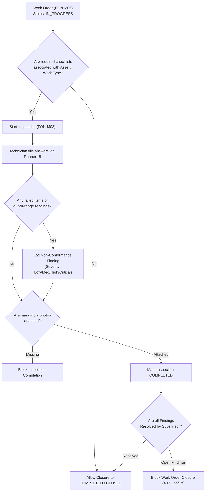

# M08 Inspection & Checklist Engine

FieldOps Nexus --- Inspection & Checklist Engine Module  
**Project:** FieldOps Nexus  
**HPE Code:** HPE-PRD-2026-FOPS02  
**Module ID:** FON-M08  
**Django App:** `apps.checklists`  
**Status:** **100% COMPLETE** (All 51 automated unit, integration, API, and UI tests passing)

---

## 1. Purpose & Project Role

The **Inspection & Checklist Engine (FON-M08)** provides authoritative, structured digital inspection workflows for field technicians, quality auditors, and maintenance supervisors. 

Within the FieldOps Nexus ERP, FON-M08 acts as the **operational quality gatekeeper**:
* Guarantees technicians execute mandatory standard operating procedures (SOPs).
* Validates physical readings against engineered tolerance limits.
* Captures indisputable photographic evidence of equipment status.
* Automatically converts out-of-spec conditions into trackable Non-Conformance Findings.
* **Blocks Work Order closure (FON-M06)** until all quality and safety criteria are satisfied.

---

## 2. Scope & Sub-Module Audit

| Sub-Module Area | PRD Requirement | Implementation Status | Evidence / Location |
|---|---|---|---|
| **Template Builder** | Dynamic checklist creation, sections, item ordering, multi-data-type questions | ✅ **Complete** | `apps/checklists/models.py` (`ChecklistTemplate`, `ChecklistItem`), `forms.py` |
| **Version Freezing** | Active templates are frozen; edits spawn auto-incremented new versions | ✅ **Complete** | `apps/checklists/services.py` (`create_template_version`) |
| **Question Types** | Boolean (Pass/Fail), Numeric (min/max range & units), Selection (options & exception list), Free Text | ✅ **Complete** | `apps/checklists/services.py` (`record_response`) |
| **Pass/Fail Scoring** | Automatic evaluation of exceptions, out-of-bounds metrics, and progress percentages | ✅ **Complete** | `apps/checklists/views.py` (`progress_pct`, `exception_count`), `services.py` |
| **Evidence & Photo Vault** | Mandatory photo proofs, HTML5 mobile camera capture, secure token downloads | ✅ **Complete** | `apps/checklists/views.py` (`InspectionUploadEvidenceView`), `runner.html` |
| **Non-Conformance Workflow** | Finding generation with severity (`LOW`, `MEDIUM`, `HIGH`, `CRITICAL`) and supervisor resolution | ✅ **Complete** | `apps/checklists/models.py` (`Finding`), `views.py` (`InspectionFindingResolveView`) |
| **Work Order Gatekeeper** | Prevents Work Order closure in M06 if required checklists are incomplete | ✅ **Complete** | `apps/checklists/services.py` (`completion_issues`), `test_m08_integration.py` |
| **Standalone Inspections** | Ad-hoc or routine inspections executed directly on Assets (M02) without a work order | ✅ **Complete** | `apps/checklists/services.py` (`start_inspection`), `test_m08_checklists.py` |
| **Interactive Runner UI** | Dynamic execution runner with progress bar, question cards, and embeddable modal | ✅ **Complete** | `templates/checklists/runner.html`, `_runner_modal.html` |
| **REST APIs** | Endpoints for templates, inspections, answers, evidence, and findings | ✅ **Complete** | `apps/checklists/api_views.py`, `urls.py` |
| **RBAC & Multi-Tenancy** | Role authorization (Planner, Technician, Supervisor) and strict tenant data isolation | ✅ **Complete** | `apps/checklists/permissions.py`, `test_m08_checklists.py` |

> **Audit Conclusion**: **Zero sub-modules are pending.** The module is 100% complete and fully verified.

---

## 3. Core Database Entities

* `ChecklistTemplate`: Template definitions with version number, state (`DRAFT`, `ACTIVE`, `INACTIVE`), and applicability rules (`work_type`, `asset_category`).
* `ChecklistItem`: Individual inspection questions with sequence, prompt, question type (`TEXT`, `BOOLEAN`, `NUMERIC`, `SELECTION`), unit, min/max bounds, exception options, and mandatory flags (`is_required`, `evidence_required`).
* `Inspection`: Concrete execution instance tied to an Asset and/or Work Order, assigned technician, status (`IN_PROGRESS`, `COMPLETED`), and execution timestamps.
* `InspectionResponse`: Captured technician answers with typed values (`value_text`, `value_bool`, `value_numeric`), out-of-bounds flag (`is_exception`), and notes.
* `Finding`: Non-conformance defect record linked to failed items with severity, mitigation notes, and resolution state.
* `InspectionEvidence`: Uploaded photos, documents, or measurements with file tokens and audit metadata.

---

## 4. Work Order Quality Gate Integration Flow

---

## 5. Verification & Test Evidence

* Full test suite: **51 automated tests**, **0 failures** (100% pass rate).
* Documentation reports:
  * Unit tests: [`docs/testing/M08_UNIT_TESTS.md`](file:///c:/Users/ABC/Desktop/Projects/Nexus/FieldOps_Nexus_Internal/docs/testing/M08_UNIT_TESTS.md)
  * Integration tests: [`docs/testing/M08_INTEGRATION_TESTS.md`](file:///c:/Users/ABC/Desktop/Projects/Nexus/FieldOps_Nexus_Internal/docs/testing/M08_INTEGRATION_TESTS.md)
  * Regression tests: [`docs/testing/M08_REGRESSION_TESTS.md`](file:///c:/Users/ABC/Desktop/Projects/Nexus/FieldOps_Nexus_Internal/docs/testing/M08_REGRESSION_TESTS.md)
