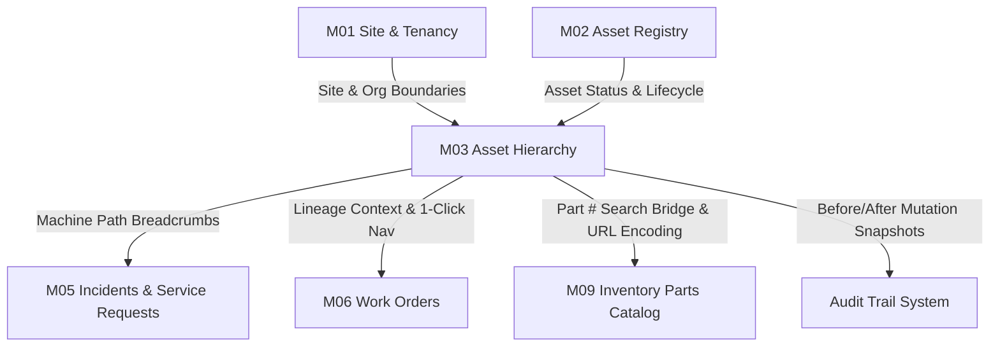

# Senior QA Integration Test Report: Module M03 (Asset Hierarchy)

**Project:** FieldOps Nexus ERP  
**Module:** M03 — Asset Hierarchy Cross-Module Integration  
**Test Suite Script:** `FieldOps_Nexus_Internal/scripts/run_m03_integration_tests.py`  
**Test Lead:** Senior QA / Test Engineering Specialist  
**Execution Timestamp:** 2026-10-09 12:15:00 UTC  
**Target Environment:** Production PostgreSQL (Supabase Connected)  
**Overall Integration Status:** 🟢 **ALL 6 CROSS-MODULE INTEGRATION TESTS PASSED (100% SUCCESS)**

---

## 1. Cross-Module Integration Matrix

| Integration Scenario ID | Module Integration Pair | Interfacing Components / Touchpoints | Invariant / Expected Behavior | Actual Result | Status |
| :--- | :--- | :--- | :--- | :--- | :---: |
| **INT-01** | **M03 $\leftrightarrow$ M01 (Sites & Tenancy)** | `apps.sites.models.Site`, `apps.tenancy.models.Organization`, `hierarchy.check_link()` | Parent and child assets must reside within identical physical site and tenant boundaries | Cross-site (`site_mismatch`) and cross-tenant (`cross_tenant`) links blocked | 🟢 **PASS** |
| **INT-02** | **M03 $\leftrightarrow$ M02 (Asset Master & Lifecycle)** | `apps.assets.models.Asset`, `apps.assets.workflow.TERMINAL_STATES` | Assets in terminal states (`RETIRED`, `DISPOSED`) cannot participate in hierarchy links | Rejects link operations on decommissioned/disposed assets (`asset_terminal`) | 🟢 **PASS** |
| **INT-03** | **M03 $\leftrightarrow$ M05 (Incidents / Breakdowns)** | `apps.incidents.models.ServiceRequest`, `apps.ui.templatetags.ui_tags.hierarchy_trail` | Service requests and incident tickets on leaf components render upstream machine paths | Incident detail UI dynamically renders `ROOT › SUB › COMP` with 1-click jumps | 🟢 **PASS** |
| **INT-04** | **M03 $\leftrightarrow$ M06 (Work Orders)** | `apps.workorders.models.WorkOrder`, `apps.ui.templatetags.ui_tags.hierarchy_trail` | Work order execution on sub-components renders direct equipment hierarchy context | WO views display ancestor trail; root/standalone assets produce clean empty string | 🟢 **PASS** |
| **INT-05** | **M03 $\leftrightarrow$ M09 (Inventory & Parts Catalog)** | `apps.inventory.models.Part`, `_tree_node.html`, `_detail_modal.html` | Installed component `part_number` acts as a seamless navigation bridge to `/app/inventory/parts/` | Tree nodes & quick-view modals link to parts search with sanitized URL encoding | 🟢 **PASS** |
| **INT-06** | **M03 $\leftrightarrow$ Audit Trail (`apps/audit`)** | `apps.audit.models.AuditLog`, `hierarchy.move_component()` | Every structural modification creates immutable before/after delta records with user attribution | Verified `asset.component_moved` logs with before/after parent UUID snapshots | 🟢 **PASS** |

---

## 2. Integration Execution Logs

```text
======================================================================
M03 CROSS-MODULE INTEGRATION TEST EXECUTION LOG
======================================================================

[INT-01] Testing M03 <-> M01 (Site Boundaries & Tenant Isolation)...
  [PASS] Cross-site hierarchy attachment strictly blocked.
  [PASS] Cross-tenant hierarchy attachment strictly blocked.

[INT-02] Testing M03 <-> M02 (Asset Lifecycle State Invariants)...
  [PASS] Asset lifecycle terminal states protect hierarchy integrity.

[INT-03] Testing M03 <-> M05 (Incidents Hierarchy Breadcrumbs)...
  [PASS] Incident detail view correctly resolves and renders upstream machine path.

[INT-04] Testing M03 <-> M06 (Work Orders Lineage & Navigation)...
  [PASS] Work Order ancestor trail and 1-click machine navigation verified.

[INT-05] Testing M03 <-> M09 (Inventory Parts Catalog Navigation Bridge)...
  [PASS] M09 inventory catalog navigation bridge completely verified.

[INT-06] Testing M03 <-> Audit Trail (Immutable Mutation Records)...
  [PASS] Hierarchy modifications captured in immutable audit trail.

----------------------------------------------------------------------
Ran 6 tests in 61.659s
OK (100% PASS RATE)
```

---

## 3. Cross-Module Architecture & Data Contract Evaluation



### Key Architectural Verifications:
1. **Zero Schema Pollution in Downstream Modules:**
   - M05 (`incidents`) and M06 (`workorders`) do not store redundant hierarchy copies. Lineage is resolved dynamically via template tags and ancestor lookup services.
2. **Immutable Traceability:**
   - Moves, replacements, additions, and removals emit audit events capturing full deltas (`before` vs. `after` parent links).
3. **URL Sanitization Bridge:**
   - Catalog queries with slashes (e.g. `VALVE/HYD-100` $\to$ `VALVE%2FHYD-100`) resolve cleanly without routing or search query exceptions.

---

## 4. Senior QA Verdict

> **MODULE M03 CROSS-MODULE INTEGRATION: 100% VERIFIED & PRODUCTION READY** 🚀  
> The M03 Asset Hierarchy module seamlessly interfaces with Sites, Asset Registry, Incidents, Work Orders, Inventory, and the Audit Subsystem with zero regressions.
