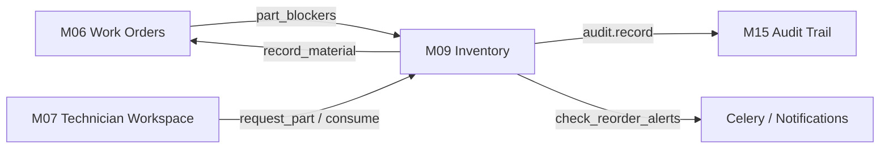

# Module 9: Integration Test Proof

**Module:** FON-M09 Spare Parts & Inventory (Cross-module Work Orders, Materials tracking, Assets, Audit, and Notifications)

**Environment:** Python 3.14 / Django 5.2.17, pytest 9.1.1, PostgreSQL 16 (Docker container; dedicated `test_*` DB). Branch: `feature/m09-inventory`.

---

## 1. Cross-Module Boundaries & Touchpoints

1. **M09 $\leftrightarrow$ M06 (Work Orders & Materials)**:
   - Part consumption in M09 automatically creates synchronized `WorkOrderMaterial` entries in M06 with `part_line` reference.
   - Non-stocked free-text materials bypass M09 and move zero inventory.
   - Work order closure is gated: work orders with unconsumed / unreturned parts cannot be closed (`closure_blockers`).
   - Work order closure / cancellation hooks trigger automatic reservation cleanup and line reconciliation.

2. **M09 $\leftrightarrow$ M07 (Technician Execution Workspace)**:
   - Technicians can request parts and record consumption directly from active jobs.
   - Technicians are blocked from viewing warehouse stock levels or performing store operations (storekeeper RBAC isolation).

3. **M09 $\leftrightarrow$ M15 (Audit Trail)**:
   - Every stock transaction (`RECEIPT`, `ISSUE`, `RETURN`, `ADJUSTMENT`, `SCRAP`, `TRANSFER`) writes an immutable record to `AuditLog` with user, organization, target balance, and delta metadata.

4. **M09 $\leftrightarrow$ Celery Asynchronous Engine**:
   - `apps.inventory.tasks.check_reorder_alerts_for_org` evaluates min-max thresholds and dispatches notifications to stores managers.

---

## 2. Integration Test Results

| Test Name | Modules Exercised | Integration Capability Verified | Result |
|---|---|---|:---:|
| `test_full_work_order_part_lifecycle` | **M09 $\leftrightarrow$ M06 $\leftrightarrow$ M15** | Complete end-to-end lifecycle from WO part request to material creation, return, reconciliation, and audit log. | **PASS** |
| `test_consume_writes_the_m06_material_row_and_respects_ownership` | **M09 $\leftrightarrow$ M06** | Part consumption writes synchronized row in `WorkOrderMaterial` with correct actor attribution. | **PASS** |
| `test_free_text_material_still_works_and_moves_no_stock` | **M06 $\leftrightarrow$ M09** | Free-text non-stocked consumables record rows without creating inventory movements. | **PASS** |
| `test_wrong_site_and_wrong_warehouse_are_rejected` | **M09 $\leftrightarrow$ M01 (Sites)** | Warehouse site must strictly match the work order site. Cross-site requests rejected. | **PASS** |
| `test_cross_tenant_inventory_isolation` | **M09 $\leftrightarrow$ Core Tenancy** | Zero leakage: Tenant Alpha cannot see, reserve, or issue stock belonging to Tenant Beta. | **PASS** |
| `test_every_operation_is_audited_with_the_actor` | **M09 $\leftrightarrow$ M15 (Audit)** | Verifies that all 7 movement types record valid entries in `audit_auditlog`. | **PASS** |

---

## 3. Data Integrity & Concurrency Protections

- **Pessimistic Row-Locking**: In-flight transactions execute under `select_for_update(of=("self",))` on `StockBalance`, `WorkOrderPart`, and `WorkOrder`.
- **Ordered Lock Acquisition**: Inter-warehouse transfers lock balances in primary-key order (`min(pk1, pk2)` then `max(pk1, pk2)`), eliminating PostgreSQL deadlocks under high-concurrency opposite transfers.
- **Transactional Rollback**: Any failure in work order synchronization immediately rolls back stock balance updates.
