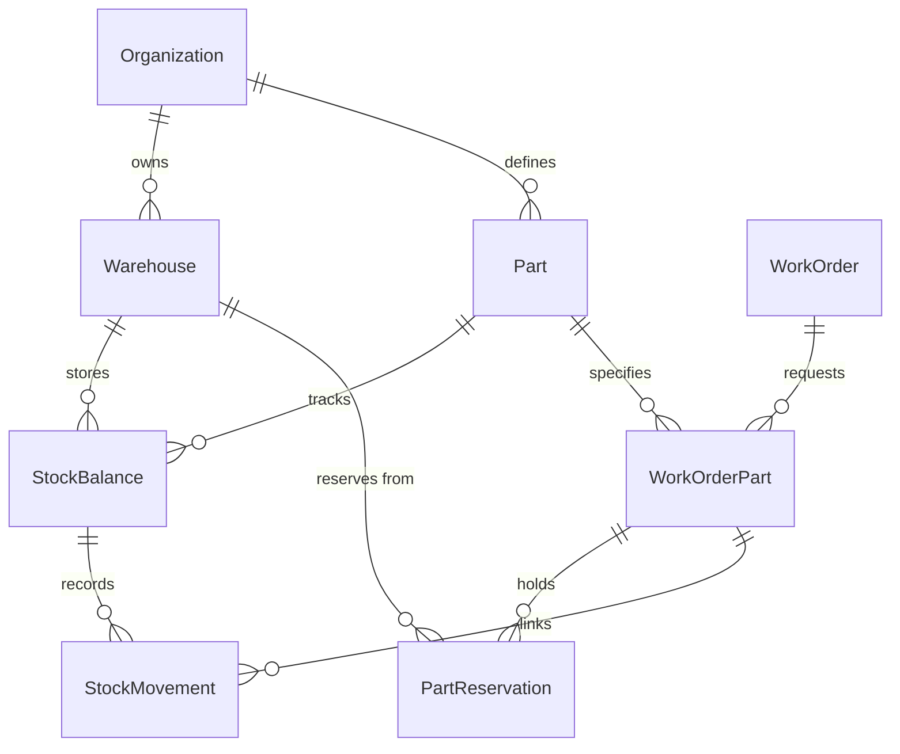
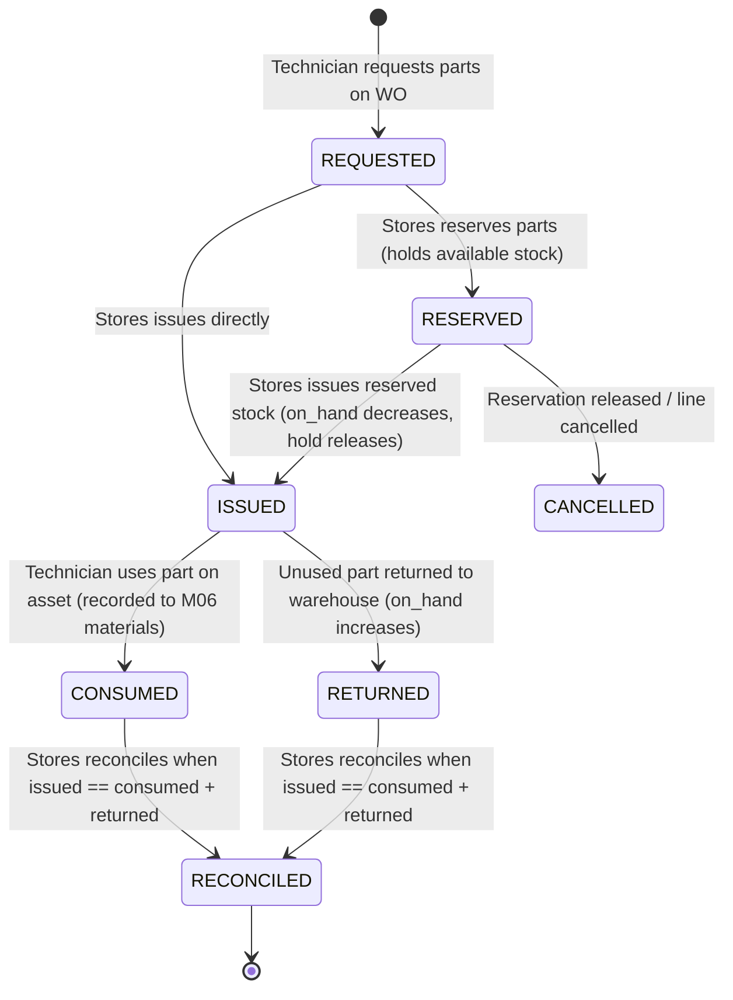

# FON-M09 Spare Parts & Inventory Management

Enterprise spare parts catalog, warehouse inventory management, and append-only transactional stock ledger for FieldOps Nexus.

---

## 1. Module Overview & Scope

The **Spare Parts & Inventory Management** module (`FON-M09`) provides centralized control over spare parts cataloging, multi-warehouse stock balances, transactional ledger accounting, technician part reservations, and automated min-max replenishment triggers.

### Key Capabilities:
- **Part Catalog**: SKU/Part number definitions, units of measure, categories, default reorder levels, cost tracking, and lifecycle status (`ACTIVE`/`INACTIVE`).
- **Warehouse Management**: Site-bound physical stores and mobile stock locations with active stock locking and deletion safeguards.
- **Append-Only Stock Ledger**: Immutable `StockMovement` records capturing every stock transition (`RECEIPT`, `ISSUE`, `RETURN`, `ADJUSTMENT`, `SCRAP`, `TRANSFER_OUT`, `TRANSFER_IN`).
- **Stock Invariant Guarantees**: Enforces `available = on_hand - reserved >= 0` and `reserved <= on_hand` via PostgreSQL check constraints and row-level pessimistic locking (`SELECT ... FOR UPDATE`).
- **6-Stage Work Order Part Lifecycle**: `REQUESTED` $\rightarrow$ `RESERVED` $\rightarrow$ `ISSUED` $\rightarrow$ `CONSUMED` / `RETURNED` $\rightarrow$ `RECONCILED`.
- **Automated Min-Max Alerts**: Periodic Celery tasks evaluating low stock conditions and notifying stores managers.
- **Audit & Compliance**: Every stock mutation is audited in `apps.audit.models.AuditLog` with actor attribution and metadata.

---

## 2. Domain Entities & Database Architecture



### Models:
1. `Part`: Organization-scoped catalog items with unique `part_number` (case-insensitive) and default min/reorder levels.
2. `Warehouse`: Site-scoped storage locations. Inactive warehouses cannot receive or issue stock; warehouses holding positive stock cannot be deactivated.
3. `StockBalance`: Composite unique record per `(organization, warehouse, part)` maintaining `on_hand`, `reserved`, and computed `available = on_hand - reserved`.
4. `StockMovement`: Append-only, immutable transaction ledger. Cannot be updated or deleted.
5. `WorkOrderPart`: Requirement line on a work order tracking `quantity_requested`, `quantity_issued`, `quantity_consumed`, and `quantity_returned`.
6. `PartReservation`: Active stock reservation holding parts in a warehouse for a specific work order line.

---

## 3. Work Order Part Lifecycle State Machine



---

## 4. REST API Endpoints

All endpoints require authentication and site-scoped RBAC permissions (`inventory.view`, `inventory.manage`, `inventory.receive`, `inventory.issue`):

| Method | Endpoint | Description |
|---|---|---|
| `GET` / `POST` | `/api/v1/inventory/parts/` | List and create spare parts |
| `GET` / `PATCH` | `/api/v1/inventory/parts/{id}/` | Retrieve and update part details |
| `GET` / `POST` | `/api/v1/inventory/warehouses/` | List and create warehouses |
| `GET` / `PATCH` | `/api/v1/inventory/warehouses/{id}/` | Retrieve and update warehouse details |
| `GET` | `/api/v1/inventory/stock-balances/` | Query real-time stock levels |
| `POST` | `/api/v1/inventory/stock-balances/receive/` | Receive new stock into warehouse |
| `POST` | `/api/v1/inventory/stock-balances/adjust/` | Perform cycle count adjustments |
| `POST` | `/api/v1/inventory/stock-balances/scrap/` | Decommission / scrap damaged stock |
| `POST` | `/api/v1/inventory/stock-balances/transfer/` | Inter-warehouse stock transfer |
| `POST` | `/api/v1/inventory/stock-balances/levels/` | Configure min/max reorder thresholds |
| `GET` | `/api/v1/inventory/stock-movements/` | Audit ledger of stock movements |
| `GET` / `POST` | `/api/v1/inventory/work-order-parts/` | Request parts for a work order |
| `POST` | `/api/v1/inventory/work-order-parts/{id}/reserve/` | Reserve parts for work order |
| `POST` | `/api/v1/inventory/work-order-parts/{id}/issue/` | Issue parts to technician |
| `POST` | `/api/v1/inventory/work-order-parts/{id}/consume/` | Record part consumption on job |
| `POST` | `/api/v1/inventory/work-order-parts/{id}/return-stock/` | Return unused parts to store |
| `POST` | `/api/v1/inventory/work-order-parts/{id}/reconcile/` | Reconcile completed part line |

---

## 5. Web UI Interface

Located at `/app/inventory/`:
- **Parts Catalog**: `/app/inventory/parts/` - Search, filter, view stock across warehouses, create parts.
- **Warehouses**: `/app/inventory/warehouses/` - View site warehouses, stock breakdowns, and activity.
- **Stock Balances**: `/app/inventory/stock/` - On-hand, reserved, and available indicators with low-stock badges.
- **Receive Stock**: `/app/inventory/receive/` - Intake form for inbound vendor receipts.
- **Stock Movement Ledger**: `/app/inventory/movements/` - Complete audit trail filterable by warehouse, part, and type.
- **Work Order Parts Tab**: `/app/work-orders/{id}/parts/` - Interactive technician/storekeeper workspace for requesting, reserving, issuing, and returning parts.

---

## 6. Celery Asynchronous Tasks

- `apps.inventory.tasks.check_reorder_alerts_for_org(org_id)`: Checks min/reorder thresholds per organization and dispatches warnings to stores managers.
- `apps.inventory.tasks.fan_out_reorder_alerts`: Periodic Beat schedule task running every 6 hours to fan out checks across all active tenants.

---

## 7. Verification & Test Suite

Run module tests against PostgreSQL:
```bash
uv run pytest tests/test_inventory.py tests/test_m09_inventory.py -v
```
